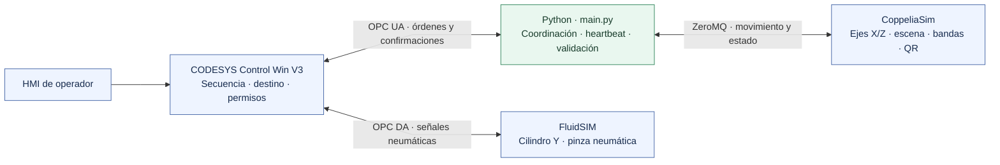
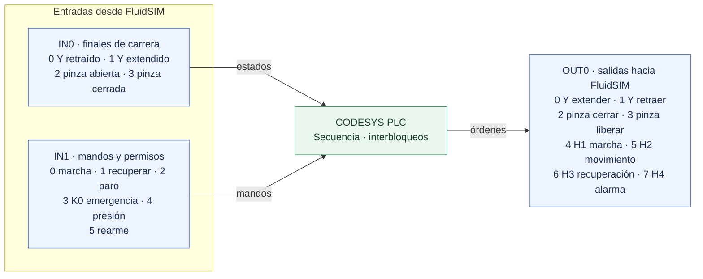

# Mini AS/RS

Coordinación en Python del sistema automatizado de almacenamiento y recuperación de sobres Mini AS/RS: rack de 4 columnas × 28 filas (112 posiciones), pórtico cartesiano con ejes X/Z eléctricos, eje Y y sujetador neumáticos, banda de entrada, banda de salida e identificación por código QR.


## Video demostrativo

Haz clic en la captura para abrir el video en Google Drive.

[](https://drive.google.com/file/d/13d0R-Bz9BVPwiDQlmKT5-XTVxBPbAl1q/view?usp=sharing)
## Arquitectura

| Componente | Función | Enlace |
|---|---|---|
| CODESYS Control Win V3 | Secuencia, permisos, asignación de ubicación e inventario operacional (HMI) | OPC UA con Python |
| FluidSIM | Circuito electroneumático del eje Y y del sujetador | OPC DA con CODESYS |
| CoppeliaSim | Planta, escena 3D, bandas y lectura de QR | ZeroMQ Remote API con Python |
| Python (`main.py`) | Coordinador: ejecuta las órdenes del PLC en la escena y devuelve confirmaciones | OPC UA y ZeroMQ |

El PLC decide la secuencia y la celda de destino; Python mueve la escena, valida cada paso y confirma al PLC solo después de guardar el inventario.

### Diagrama de arquitectura



La banda de salida está implementada en `control_banda_salida.py` y es utilizada por el módulo de recuperación.
### Circuito neumático e integración

El circuito de FluidSIM representa el eje Y y la pinza neumática. El suministro comprende compresor 0P1, unidad de mantenimiento indicada a 6 bar y presostato 0B1 indicado a 4 bar. El cilindro de doble efecto 1A1 mueve Y mediante válvula 5/2 biestable, reguladores de caudal y finales de carrera 1B1/1B2. El actuador de simple efecto 1A2 acciona la pinza por válvula 3/2 biestable, con regulación de caudal y sensores 2B1/2B2. S1/S4/S2/S3 gestionan marcha, recuperación, paro y rearme; S0/K0 informa el estado de emergencia. H1–H4 señalan marcha, movimiento, recuperación y alarma.

FluidSIM intercambia señales con el PLC por OPC DA: posiciones y mandos llegan por `IN0`/`IN1`, y órdenes de válvula y pilotos salen por `OUT0`. Python enlaza con el PLC por OPC UA y con CoppeliaSim por ZeroMQ Remote API. En la co-simulación, el PLC y FluidSIM modelan las órdenes y confirmaciones neumáticas de Y y la pinza; Python refleja esos movimientos en la planta 3D de CoppeliaSim y ejecuta allí la cinemática X/Z, las bandas y la identificación QR. Los ejes X/Z están representados en la escena virtual. El [detalle del circuito e interconexión](docs/arquitectura_neumatica.md) resume los componentes y la interconexión.

El flujo funcional recibe e identifica el sobre, asigna celda, lo recoge con Y y la pinza, lo desplaza por X/Z, deposita o despacha y actualiza el inventario QR. Los valores de presión del plano describen la configuración nominal representada en la simulación.
### Diagrama lógico de entradas y salidas



El detalle canal por canal y la tabla de errores con acciones de recuperación están en [el mapa lógico de E/S y alarmas](docs/mapa_io_y_errores.md).

Versiones identificadas en el laboratorio: CODESYS V3.5 SP9 Patch 1+ y FluidSIM 4.2p/1.67 Pneumática. Según la información del usuario, corresponden a licencias académicas del laboratorio de la Uniagustiniana.

La descripción ampliada de funciones, flujo de datos, heartbeat y campañas está en [funcionamiento y arquitectura](docs/funcionamiento_y_arquitectura.md).
## Estructura

| Ruta | Contenido |
|---|---|
| `main.py` | Coordinador PLC ↔ CoppeliaSim |
| `config.py` | Dirección OPC UA, símbolos, perfiles de velocidad y aceleración, límites de supervisión |
| `codesys_opcua.py` | Cliente OPC UA con descubrimiento de namespace y escritura tipada |
| `coppelia_bridge.py` | Conexión con CoppeliaSim |
| `control_portico.py`, `control_gripper.py` | Movimiento de ejes con perfil trapezoidal y control del sujetador |
| `control_banda_integrado.py`, `control_banda_salida.py` | Banda de entrada (creación de sobres) y banda de salida |
| `lector_qr.py` | Lectura de QR desde el sensor de visión |
| `inventario.py`, `sincronizacion_escena.py` | Inventario JSON y reconstrucción de la ocupación desde la escena |
| `recuperacion.py` | Extracción desde el rack y entrega en la segunda banda |
| `evaluar_estrategias.py` | Comparación de estrategias de asignación con el modelo de tiempos |
| `diagnostico.py` | Verificación de símbolos OPC UA, inventario y coordenadas |
| `Coordenadas_Rack_Mini_ASRS.xlsx` | Coordenadas de las 112 celdas |
| `inventario_plantilla.json` | Rack vacío; se copia como `inventario_mini_asrs.json` en la primera ejecución |
| `QR_Mini_ASRS/` | Códigos QR AS-001 a AS-112 |
| `banco_pruebas_112/` | Banco de pruebas de 112 posiciones: modelo, registro OPC UA y campaña conectada por bloques |
| `experimentos/` | Campaña pareada de políticas R y C, registro experimental y análisis |

## Instalación

Requiere Windows, Python 3.11 o superior, CODESYS Control Win V3, FluidSIM y CoppeliaSim con la escena del proyecto.

```powershell
py -3 -m venv .venv
.\.venv\Scripts\python.exe -m pip install -r requirements.txt
```

En VS Code, las tareas de `.vscode/tasks.json` crean el entorno, ejecutan el diagnóstico y lanzan el coordinador. La dirección del servidor OPC UA se define con `ASRS_OPC_URL`. El valor por defecto del código es `opc.tcp://192.168.0.21:4840`; las tareas de VS Code lo reemplazan por `opc.tcp://localhost:4840`. Ajusta la tarea al endpoint real del runtime antes de conectar.

## Ejecución

1. Descargar el proyecto CODESYS al runtime y dejar el PLC en espera, detenido y sin órdenes.
2. Abrir la escena en CoppeliaSim y FluidSIM con el enlace OPC DA activo.
3. Ejecutar `python diagnostico.py` para comprobar símbolos, inventario y coordenadas.
4. Ejecutar `python main.py`. El coordinador sincroniza el inventario con la escena y queda listo; la marcha se da desde la HMI.

## Banco de pruebas

```powershell
# Cobertura de las 112 celdas con dobles de prueba, sin mover la escena
python .\banco_pruebas_112\banco_112.py modelo --proyecto . --salida .\logs_112

# Registro OPC UA de solo lectura de lo que se opere desde la HMI
python .\banco_pruebas_112\banco_112.py registrar --proyecto . --salida .\logs_112

# Campaña conectada: llenado de 112 sobres y 112 recuperaciones, por bloques
python .\banco_pruebas_112\banco_112.py campana --proyecto . --salida .\logs_112 --estrategia 0 --confirmar-movimientos --inicio-runtime auto
```

La campaña conectada trabaja por bloques dentro del tiempo de funcionamiento del runtime CODESYS (`--limite-runtime-min`, 60 por defecto). Antes del límite envía un paro normal, espera el reposo confirmado del PLC y de los actuadores y guarda `continuar_campana.json`. `--reanudar` continúa la campaña desde ese punto. `temporizador_runtime.py` muestra el tiempo restante del runtime y avisa en los umbrales configurados.

Pruebas automatizadas:

```powershell
cd banco_pruebas_112
python -m unittest test_banco test_sesiones_runtime pruebas_fallas
```

## Experimentos

`experimentos/campana_rc.py` compara la asignación aleatoria uniforme (R) con la de mínimo costo de ubicación (C) sobre el modelo rápido de tiempos. Usa ocupaciones K = 28, 56 y 84, calentamiento de 3K parejas recuperar + almacenar y 200 parejas medidas por corrida. Ambas políticas reciben el mismo inventario inicial y la misma secuencia de solicitudes por identificador; los flujos aleatorios de inventario, demanda y selección de R se separan con `numpy.random.SeedSequence`.

```powershell
python .\experimentos\campana_rc.py --replicas 10
python .\experimentos\analizar_experimentos.py pareado --campana <id_campana>
python .\experimentos\analizar_experimentos.py potencia --campana <id_piloto> --delta 1.0
python .\experimentos\analizar_experimentos.py contraste --corridas <run_id> [<run_id> ...]
python .\experimentos\analizar_experimentos.py verificar
```

### Registro experimental

`experimentos/registro_experimental.py` guarda cada corrida en `datos_experimentos/<nivel>/<run_id>/`:

| Archivo | Contenido |
|---|---|
| `manifiesto.json` | Commit y estado del código, huella SHA-256 de los fuentes, equipo, versiones de software, entorno de licencia, escenario, política, semillas, hash del inventario inicial, perfil v/a y geometría |
| `operaciones.csv` | Una fila por operación: run_id, réplica, política, ocupación, fase (calentamiento o medida), QR, STORE/RETRIEVE, celda, inicio y fin en reloj simulado y monotónico, recorrido por eje, resultado, fallo, reintento e intervención humana |
| `interrupciones.csv` | Causa, inicio, fin y duración de cada pausa o corte |
| `fallos.csv` | Intentos fallidos y su consecuencia |
| `eventos.jsonl` | Traza de eventos con fecha UTC |

Los niveles son A (pruebas del selector), B (modelo rápido), C (contraste integrado), D (cobertura funcional) y E (fallos y recuperación). Al cerrar una corrida se sellan los archivos con SHA-256, quedan de solo lectura y se agrega una fila a `datos_experimentos/registro_corridas.csv`. Los análisis se escriben en `datos_experimentos/analisis/` con el hash de cada archivo de entrada, de modo que tablas y gráficos se regeneran desde los datos originales.

El análisis pareado toma la corrida como unidad experimental: calcula por ocupación el número de parejas, la media y dispersión por política, la diferencia d = T_R − T_C, su intervalo de confianza del 95 % (prueba t relacionada), la diferencia relativa y los fallos. Las corridas incompletas o sin pareja se reportan en `excluidas.csv`. El contraste compara, operación por operación, el tiempo del modelo con el tiempo integrado y reporta MAE, sesgo, máximo, percentil 95 y fracción dentro de la tolerancia max(0,5 s; 5 %).

## Requerimientos y alcance de uso

- Windows y Python 3.11 o superior.
- Paquetes Python declarados en `requirements.txt`, incluidos `pyzmq` y `cbor2` para ZeroMQ.
- Runtime CODESYS Control Win V3 con símbolos OPC UA compatibles.
- FluidSIM con el enlace OPC DA y el proyecto PLC configurados.
- CoppeliaSim con la escena y objetos nombrados que esperan los controladores.

Los resultados de modelo, dobles de prueba y ejecución conectada deben distinguirse de una validación física.

## Autores

Juan David González Chávez y Ginneth Rubio Camacho.
