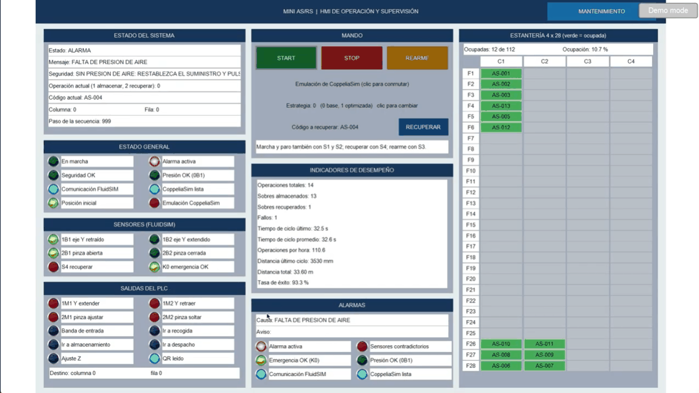
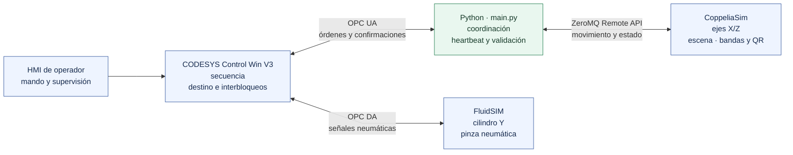

# Mini AS/RS

Coordinación en Python del sistema automatizado de almacenamiento y recuperación de sobres Mini AS/RS: rack de 4 columnas × 28 filas (112 posiciones), pórtico cartesiano con ejes X/Z eléctricos, eje Y y sujetador neumáticos, banda de entrada, banda de salida e identificación por código QR.

## Video demostrativo

Haz clic en la captura para abrir el video en Google Drive.

[](https://drive.google.com/file/d/13d0R-Bz9BVPwiDQlmKT5-XTVxBPbAl1q/view?usp=sharing)

## Arquitectura

| Componente | Función | Enlace |
|---|---|---|
| CODESYS Control Win V3 | Secuencia, permisos, asignación de ubicación e inventario operacional (HMI) | OPC UA con Python |
| FluidSIM | Circuito electroneumático del eje Y y del sujetador | OPC DA con CODESYS |
| CoppeliaSim | Planta, escena 3D, bandas y lectura de QR | ZeroMQ Remote API con Python |
| Python (`main.py`) | Coordinador: ejecuta las órdenes del PLC en la escena y devuelve confirmaciones | OPC UA y ZeroMQ |

El PLC decide la secuencia y la celda de destino; Python mueve la escena, valida cada paso y confirma al PLC solo después de guardar el inventario.

### Diagrama de arquitectura



### Circuito neumático e integración

El circuito de FluidSIM representa el eje Y y la pinza neumática. El suministro comprende compresor 0P1, unidad de mantenimiento indicada a 6 bar y presostato 0B1 indicado a 4 bar. El cilindro de doble efecto 1A1 mueve Y mediante válvula 5/2 biestable, reguladores de caudal y finales de carrera 1B1/1B2. El actuador de simple efecto 1A2 acciona la pinza por válvula 3/2 biestable, con regulación de caudal y sensores 2B1/2B2. S1/S4/S2/S3 gestionan marcha, recuperación, paro y rearme; S0/K0 informa el estado de emergencia. H1 a H4 señalan marcha, movimiento, recuperación y alarma.

FluidSIM intercambia señales con el PLC por OPC DA: posiciones y mandos llegan por `IN0`/`IN1`, y órdenes de válvula y pilotos salen por `OUT0`. Python enlaza con el PLC por OPC UA y con CoppeliaSim por ZeroMQ Remote API. En la co-simulación, el PLC y FluidSIM modelan las órdenes y confirmaciones neumáticas de Y y la pinza; Python refleja esos movimientos en la planta 3D de CoppeliaSim y ejecuta allí la cinemática X/Z, las bandas y la identificación QR. El [detalle del circuito](docs/arquitectura_neumatica.md) describe los componentes y la interconexión.

El flujo funcional recibe e identifica el sobre, asigna celda, lo recoge con Y y la pinza, lo desplaza por X/Z, deposita o despacha y actualiza el inventario QR. Las presiones indicadas son los valores nominales del circuito simulado.

### Entradas y salidas

FluidSIM entrega al PLC los finales de carrera del eje Y y de la pinza por `IN0` y los mandos y permisos (marcha, recuperar, paro, emergencia, presión y rearme) por `IN1`. El PLC devuelve por `OUT0` las órdenes de las válvulas y los pilotos H1 a H4. El diagrama, el detalle canal por canal y la tabla de alarmas con su acción de recuperación están en el [mapa de E/S y alarmas](docs/mapa_io_y_errores.md).

La descripción ampliada de funciones, flujo de datos, heartbeat y campañas, junto con las versiones de software utilizadas, está en [funcionamiento y arquitectura](docs/funcionamiento_y_arquitectura.md).

## Estructura

```text
Mini-ASRS/
├── coordinador/                  Coordinador Python
│   ├── main.py                   Coordinador PLC ↔ CoppeliaSim
│   ├── config.py                 Dirección OPC UA, símbolos, perfiles v/a, límites de supervisión y rutas de datos
│   ├── diagnostico.py            Verificación de símbolos OPC UA, inventario y coordenadas
│   ├── rutas.py                  Rutas de importación de las carpetas del coordinador
│   ├── comunicacion/
│   │   ├── codesys_opcua.py      Cliente OPC UA con descubrimiento de namespace y escritura tipada
│   │   └── coppelia_bridge.py    Conexión con CoppeliaSim
│   ├── movimiento/
│   │   ├── control_portico.py    Ejes X/Y/Z con perfil trapezoidal
│   │   ├── control_gripper.py    Sujetador
│   │   ├── control_banda_integrado.py   Banda de entrada y creación de sobres
│   │   ├── control_banda_salida.py      Banda de salida
│   │   └── recuperacion.py       Extracción del rack y entrega en la segunda banda
│   ├── almacen/
│   │   ├── inventario.py         Inventario JSON
│   │   ├── sincronizacion_escena.py     Reconstrucción de la ocupación desde la escena
│   │   └── lector_qr.py          Lectura de QR desde el sensor de visión
│   └── estrategias/
│       ├── estrategias_colocacion.py    Estrategias 0, 1 y 2 y verificación del destino elegido por el PLC
│       ├── evaluar_estrategias.py       Comparación de estrategias con el modelo de tiempos
│       └── test_estrategias_colocacion.py
├── datos/
│   ├── Coordenadas_Rack_Mini_ASRS.xlsx  Coordenadas de las 112 celdas
│   ├── inventario_plantilla.json        Rack vacío; se copia como inventario_mini_asrs.json en la primera ejecución
│   ├── QR_Mini_ASRS/                    Códigos QR AS-001 a AS-112
│   └── resultados_*.csv                 Salida de evaluar_estrategias.py
├── banco_pruebas_112/            Banco de pruebas de 112 posiciones: modelo, registro OPC UA y campaña por bloques
├── experimentos/                 Campaña pareada R/C, registro experimental y análisis
└── docs/                         Arquitectura, mapa de E/S, alarmas y funcionamiento
```

El inventario de trabajo (`datos/inventario_mini_asrs.json`) y sus respaldos se generan al ejecutar y no se versionan.

## Instalación

Requiere Windows, Python 3.11 o superior, CODESYS Control Win V3, FluidSIM y CoppeliaSim con la escena del proyecto.

```powershell
py -3 -m venv .venv
.\.venv\Scripts\python.exe -m pip install -r requirements.txt
```

En VS Code, las tareas de `.vscode/tasks.json` crean el entorno, ejecutan el diagnóstico y lanzan el coordinador.

El coordinador y el banco se conectan al runtime CODESYS del mismo equipo (`opc.tcp://localhost:4840`) y a CoppeliaSim en su puerto local por defecto, de modo que basta con clonar el repositorio y ejecutarlo en el equipo donde corren las tres aplicaciones. Las rutas de datos se resuelven desde la carpeta del repositorio. Solo si CODESYS está en otro equipo se define la variable de entorno `ASRS_OPC_URL` con su dirección.

## Ejecución

1. Descargar el proyecto CODESYS al runtime y dejar el PLC en espera, detenido y sin órdenes.
2. Abrir la escena en CoppeliaSim y FluidSIM con el enlace OPC DA activo.
3. Ejecutar `python coordinador\diagnostico.py` para comprobar símbolos, inventario y coordenadas.
4. Ejecutar `python coordinador\main.py`. El coordinador sincroniza el inventario con la escena y queda listo; la marcha se da desde la HMI.

## Estrategias de asignación

El PLC elige la celda de destino según `GVL_HMI.iEstrategia`, seleccionable en la HMI:

| Valor | Estrategia | Criterio |
|---|---|---|
| 0 | Secuencial | Primera celda libre por índice |
| 1 | Menor distancia | Menor suma de distancias X y Z desde la recogida |
| 2 | Menor tiempo | Menor tiempo estimado de ida, apoyo y retorno con los perfiles trapezoidales de X y Z |

En las tres, el empate se resuelve por el menor índice. Con la estrategia 2, `main.py` recalcula el costo antes de mover el pórtico y rechaza el destino si no empata con el mínimo entre las celdas libres; la comparación admite diferencias menores a 1 ms porque el PLC calcula en `REAL`. Las constantes `VX_MM_S`, `VZ_MM_S`, `AX_MM_S2` y `AZ_MM_S2` de `GVL_HMI` deben coincidir con `config.py` en mm, y el PLC publica `GVL_HMI.iVersionEstrategias = 2`, que el banco exige antes de iniciar una campaña con la estrategia 2.

`python coordinador\estrategias\evaluar_estrategias.py` regenera `datos/resultados_*.csv`. Con los perfiles actuales (0,25 m/s y 0,5 m/s² en X y Z), las estrategias 1 y 2 eligen las mismas celdas; la 2 se diferencia cuando X y Z tienen velocidades o aceleraciones distintas.

## Banco de pruebas

```powershell
# Almacenar y recuperar las 112 celdas con las tres estrategias (672 operaciones) con dobles de prueba, sin mover la escena
python .\banco_pruebas_112\banco_112.py modelo

# Registro OPC UA de solo lectura de lo que se opere desde la HMI
python .\banco_pruebas_112\banco_112.py registrar

# Campaña conectada: llenado de 112 sobres y 112 recuperaciones, por bloques
python .\banco_pruebas_112\banco_112.py campana --estrategia 2 --confirmar-movimientos --inicio-runtime auto
```

La campaña conectada trabaja por bloques dentro del tiempo de funcionamiento del runtime CODESYS (`--limite-runtime-min`, 60 por defecto). Antes del límite envía un paro normal, espera el reposo confirmado del PLC y de los actuadores y guarda `continuar_campana.json`. `--reanudar` continúa la campaña desde ese punto. `banco_pruebas_112/temporizador_runtime.py` muestra el tiempo restante del runtime y avisa en los umbrales configurados.

Pruebas automatizadas:

```powershell
cd banco_pruebas_112
python -m unittest test_banco test_sesiones_runtime test_supervisor pruebas_fallas
cd ..\coordinador\estrategias
python -m unittest test_estrategias_colocacion
```

## Experimento automatizado

```powershell
python experimento.py               # fases A, E y B, sin conexión
python experimento.py --conectado   # además la fase D con CODESYS, FluidSIM y CoppeliaSim
```

El protocolo se fija en `experimento.json` antes de ejecutar (diferencia mínima relevante, semillas, réplicas, ocupaciones y parámetros del runtime) y su hash queda en cada corrida. Las fases se ejecutan en orden:

| Fase | Contenido |
|---|---|
| A | Pruebas del selector, del banco y del supervisor; si alguna falla no se ejecutan campañas |
| E | Fallos y recuperación del controlador con dobles de prueba |
| B | Piloto R vs C, tamaño de muestra con `delta_min_s`, campaña final con semilla nueva y análisis pareado |
| D | Llenado de 112 sobres y 112 recuperaciones en el sistema integrado, con el supervisor de campaña |

El resumen de cada ejecución queda en `datos_experimentos/ejecuciones/<fecha>/resumen.json`.

### Supervisor de la campaña conectada

`banco_pruebas_112/supervisor_campana.py` ejecuta la campaña por bloques y la mantiene en marcha sin intervención:

- Antes del límite del runtime CODESYS (`limite_runtime_min` menos el margen) envía paro normal, espera el reposo confirmado y guarda el punto de continuación. Si el runtime todavía tiene tiempo, sigue con el bloque siguiente; si no, espera a que CODESYS se reinicie y continúa.
- Si FluidSIM pierde los permisos, el PLC congela el paso y el banco espera su regreso hasta `--espera-comunicacion-s` sin cerrar el bloque.
- Si CODESYS se desconecta, reintenta la conexión con esperas crecientes de 5 a 30 s, relanza `main.py`, toma el inventario resincronizado con la escena y reanuda desde la fase en que iba. El ciclo interrumpido no se contabiliza.
- Una alarma del proceso, un inventario incoherente o un sobre sujeto detienen la campaña sin rearmar.

Cada evento queda en `logs_112/<fecha>_supervisor/` (`supervisor.jsonl`, `estado.json` con el estado actual, `main_*.log` y la carpeta de cada bloque) y la campaña completa en una corrida de nivel D del registro experimental, con las operaciones de todos los bloques, las interrupciones con su causa y duración y los fallos.

## Experimentos

`experimentos/campana_rc.py` compara la asignación aleatoria uniforme (R) con la de mínimo costo de ubicación (C) sobre el modelo rápido de tiempos. Usa ocupaciones K = 28, 56 y 84, calentamiento de 3K parejas recuperar + almacenar y 200 parejas medidas por corrida. Ambas políticas reciben el mismo inventario inicial y la misma secuencia de solicitudes por identificador; los flujos aleatorios de inventario, demanda y selección de R se separan con `numpy.random.SeedSequence`.

```powershell
python .\experimentos\campana_rc.py --replicas 10
python .\experimentos\analizar_experimentos.py pareado --campana <id_campana>
python .\experimentos\analizar_experimentos.py potencia --campana <id_piloto> --delta 1.0
python .\experimentos\analizar_experimentos.py contraste --corridas <run_id> [<run_id> ...]
python .\experimentos\analizar_experimentos.py verificar
```

### Registro experimental

`experimentos/registro_experimental.py` guarda cada corrida en `datos_experimentos/<nivel>/<run_id>/`:

| Archivo | Contenido |
|---|---|
| `manifiesto.json` | Commit y estado del código, huella SHA-256 de los fuentes, equipo, versiones de software, entorno de licencia, escenario, política, semillas, hash del inventario inicial, perfil v/a y geometría |
| `operaciones.csv` | Una fila por operación: run_id, réplica, política, ocupación, fase (calentamiento o medida), QR, STORE/RETRIEVE, celda, inicio y fin en reloj simulado y monotónico, recorrido por eje, resultado, fallo, reintento e intervención humana |
| `interrupciones.csv` | Causa, inicio, fin y duración de cada pausa o corte |
| `fallos.csv` | Intentos fallidos y su consecuencia |
| `eventos.jsonl` | Traza de eventos con fecha UTC |

Los niveles son A (pruebas del selector), B (modelo rápido), C (contraste integrado), D (cobertura funcional) y E (fallos y recuperación). Al cerrar una corrida se sellan los archivos con SHA-256, quedan de solo lectura y se agrega una fila a `datos_experimentos/registro_corridas.csv`. Los análisis se escriben en `datos_experimentos/analisis/` con el hash de cada archivo de entrada, de modo que tablas y gráficos se regeneran desde los datos originales.

El análisis pareado toma la corrida como unidad experimental: calcula por ocupación el número de parejas, la media y dispersión por política, la diferencia d = T_R − T_C, su intervalo de confianza del 95 % (prueba t relacionada), la diferencia relativa y los fallos. Las corridas incompletas o sin pareja se reportan en `excluidas.csv`. El contraste compara, operación por operación, el tiempo del modelo con el tiempo integrado y reporta MAE, sesgo, máximo, percentil 95 y fracción dentro de la tolerancia max(0,5 s; 5 %).

## Requerimientos y alcance de uso

- Windows y Python 3.11 o superior.
- Paquetes Python declarados en `requirements.txt`, incluidos `pyzmq` y `cbor2` para ZeroMQ.
- Runtime CODESYS Control Win V3 con símbolos OPC UA compatibles.
- FluidSIM con el enlace OPC DA y el proyecto PLC configurados.
- CoppeliaSim con la escena y objetos nombrados que esperan los controladores.

Los resultados de modelo, dobles de prueba y ejecución conectada deben distinguirse de una validación física.

## Autores

Juan David González Chávez y Ginneth Rubio Camacho.
