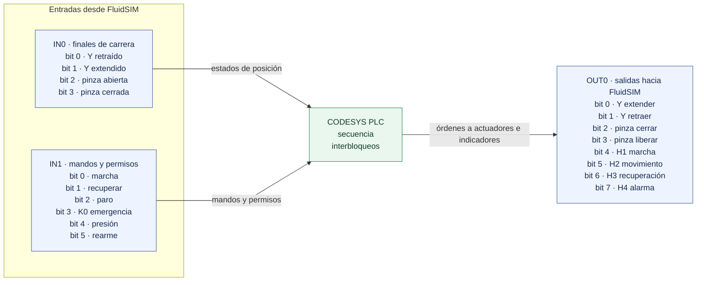

# Mapa lógico de entradas, salidas y alarmas

## Alcance

Este documento transcribe el mapa lógico del texto de PLC y del diagrama funcional de FluidSIM aportados por el usuario. No es un plano de bornes ni confirma tensiones, modelos instalados o continuidad del cableado físico. El diagrama permite cotejar asignaciones funcionales, pero para energizar el equipo hay que verificar el proyecto descargado y el cableado real.

## Diagrama lógico de E/S

### Entradas digitales

| Canal lógico | Señal | Elemento/función | Interpretación funcional indicada |
|---|---|---|---|
| IN0.0 | Eje Y retraído | 1B1 | Final de carrera de retraído |
| IN0.1 | Eje Y extendido | 1B2 | Final de carrera de extendido |
| IN0.2 | Pinza abierta | 2B1 | Confirmación de pinza abierta |
| IN0.3 | Pinza cerrada | 2B2 | Confirmación de pinza cerrada |
| IN1.0 | Marcha | S1, NA | Orden de marcha por flanco |
| IN1.1 | Recuperar | S4, NA | Solicitud de recuperación |
| IN1.2 | Paro | S2, NC | Estado del circuito de paro; abrir el contacto detiene/pausa según secuencia |
| IN1.3 | Emergencia OK | K0 | Debe permanecer activo para permitir operación; al caer produce alarma de emergencia |
| IN1.4 | Presión OK | 0B1 | Permiso neumático; pérdida sostenida 1 s dispara alarma |
| IN1.5 | Rearme | S3, NA | Solicitud de rearme por flanco |

IN1.6 e IN1.7 no tienen señal asignada en el mapa lógico mostrado.

### Salidas digitales

| Canal lógico | Señal | Elemento/función | Comportamiento indicado |
|---|---|---|---|
| OUT0.0 | Extender eje Y | Bobina 1M1 | Acciona avance del actuador Y |
| OUT0.1 | Retraer eje Y | Bobina 1M2 | Acciona retorno del actuador Y |
| OUT0.2 | Ajustar pinza | Bobina 2M1 | Orden de cierre/sujeción |
| OUT0.3 | Soltar pinza | Bobina 2M2 | Orden de apertura/liberación |
| OUT0.4 | H1 | Indicador de marcha | Encendido durante estado en marcha |
| OUT0.5 | H2 | Indicador de movimiento | Encendido con órdenes de desplazamiento/ajuste |
| OUT0.6 | H3 | Indicador de recuperación | Encendido en operación de recuperación |
| OUT0.7 | H4 | Indicador de alarma | Encendido con alarma PLC; la lógica lo apaga si se pierde comunicación con FluidSIM |

La lógica indica que las bobinas de actuador y varias órdenes de movimiento se desactivan ante alarma, emergencia, baja presión o pérdida de comunicación FluidSIM. Esta revisión de software no demuestra que el paro de emergencia sea una función de seguridad certificada: se necesita verificar el circuito independiente, hardware, categoría/PL requerido y análisis de riesgos.

## Códigos de ventana de error y respuesta

Los números son códigos de presentación de la ventana HMI. El código 9 representa una pausa por falta de comunicación FluidSIM; no equivale a la alarma de secuencia 999. El código 0 significa que no hay ventana activa.

| Código HMI | Condición o mensaje | Respuesta indicada | Observación funcional |
|---:|---|---|---|
| 0 | Sin error activo | — | Estado normal |
| 1 | Error del coordinador Python | Revisar consola Python y conexión OPC UA; corregir y rearmar | Se presenta el mensaje recibido desde el coordinador |
| 2 | Emergencia S0 activada / K0 no confirma | Desbloquear S0 en la simulación y rearmar | IN1.3 debe indicar estado de emergencia correcto |
| 3 | Sensores contradictorios en eje Y o pinza | Revisar finales de carrera y rearmar | Se activa si ambos extremos del mismo actuador aparecen activos simultáneamente |
| 4 | Falta de presión de aire | Restablecer suministro en FluidSIM y rearmar | La pérdida debe persistir 1 s con comunicación FluidSIM confirmada |
| 5 | CoppeliaSim no responde/no está listo | Verificar escena en ejecución y coordinador conectado | En secuencia activa, la comunicación integrada es requisito salvo emulación habilitada |
| 6 | Tiempo de paso excedido | Revisar el estado/movimiento indicado y rearmar | Límites configurados en el PLC: actuadores 15 s; movimientos y pasos supervisados 30 s |
| 7 | Código QR duplicado | Retirar o resolver el sobre repetido y rearmar | El mensaje contiene el identificador detectado |
| 8 | Estantería llena | Recuperar sobres para liberar una celda y rearmar | No existe una posición disponible para el depósito |
| 9 | Sin comunicación con FluidSIM | Iniciar FluidSIM; la secuencia permanece en pausa | Supervisión de comunicación de 1 s; no registra por sí misma una alarma de operación |

El error genérico de Python puede incluir causas diferentes; el HMI aconseja revisar consola y OPC UA, pero no permite identificar una causa única sin el mensaje de Python y el registro de eventos. El historial disponible en HMI conserva hasta cinco alarmas; el registro de eventos añade cambios de paso, mensaje y estrategia.

## Comunicación y secuencia

- El PLC comprueba el heartbeat de Python: si permanece sin cambios durante 10 s, declara Python desconectado. La comunicación operativa también requiere CoppeliaSim conectado, inventario listo y ausencia de error Python.
- La comunicación con FluidSIM se reconoce mediante K0 o el contacto normalmente cerrado de paro, sostenidos por la supervisión durante 1 s. Con pérdida, la secuencia se congela en el paso actual y las órdenes a actuadores se retiran.
- Los actuadores neumáticos disponen de confirmación de fin de carrera; los movimientos coordinados esperan confirmaciones del sistema de escena y aplican límites de tiempo.
- Las operaciones cubren recepción, identificación QR, selección de destino, recogida, depósito, actualización de inventario y recuperación/despacho. La recuperación puede quedar en cola si la máquina ya está ocupada.
- El modo de simulación de CoppeliaSim emula señales y tiempos para pruebas funcionales. Esos ensayos no constituyen validación del hardware ni del circuito de seguridad.

## Versiones y licencia del laboratorio

Las capturas aportadas identifican CODESYS V3.5 SP9 Patch 1+ y FluidSIM 4.2p/1.67 Pneumática (fecha mostrada: 19.02.2010). Según la información suministrada por el usuario, ambas instalaciones corresponden a licencias académicas del laboratorio de la Uniagustiniana. Las capturas no muestran titularidad, número de licencia, edición exacta del runtime ni configuración de OPC; esos detalles se deben verificar en los cuadros de licencia y en el proyecto instalado antes de reproducir el montaje.

## Asignación de emergencia

El texto de PLC y el diagrama funcional asignan la confirmación de emergencia K0 a IN1.3.
